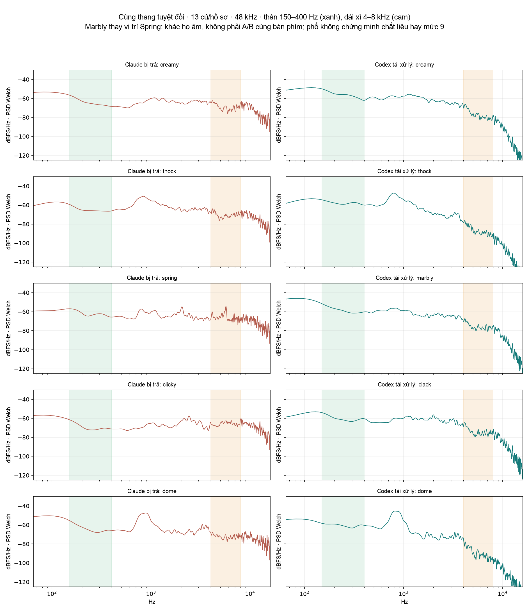

# Phiếu 182 · Năm hồ sơ tiếng phím · Codex

## Công cụ có trong phiên này — báo trước

- **Tạo âm:** không có công cụ tạo SFX tích hợp riêng của OpenAI. Có connector Topview tạo SFX qua dịch vụ mạng, cần Canvas; không dùng vì phiếu cấm tải file âm thanh từ mạng. Stable Audio 3 Small-SFX cục bộ đã cài tại `~/AudioLab/models/stable-audio-3/optimized/mlx`, nhưng phép thử import MLX trong sandbox lỗi `ImportError: [metal::load_device] No Metal device available`. Venv Audio Lab chung không có MLX; venv riêng của Stable Audio có MLX nhưng không truy cập được Metal. Không sinh âm mới trong phiên này.
- **Sửa âm, chạy Python:** có Python 3.12 trong `~/AudioLab/.venv`, NumPy, SciPy, SoundFile, pyloudnorm và Matplotlib. Dùng DSP cục bộ để dựng lại từ các cú gõ Stable Audio 3 của lượt trước; không dùng tiếng tổng hợp sin/nhiễu làm tài sản.
- **ffmpeg/ffprobe:** có ffmpeg 9.0.2 tại `/opt/homebrew/bin/ffmpeg`; dùng đo EBU R128/true peak, mã hóa Vorbis và MP3.
- **Mạng:** có công cụ duyệt trang web để tìm và kiểm giấy phép. Không tải file âm thanh, không tải trọng số, không gửi âm lên dịch vụ.
- **Nghe:** Codex không nghe được bằng tai trong phiên này. Số đo không xác nhận chất liệu nhôm, độ sang hay mức 9; chủ dự án cần nghe file.

## Trạng thái

**Đã dựng đủ năm bộ ứng viên và file nghe. Cổng định dạng, độ dài, đầu tiếng, độ to, đỉnh thật và tương quan đã đạt. Chưa hoàn tất chất liệu/mức 9; còn phần lan sát transient của OGG.** Nền ở giữa khoảng lặng đạt −70 dBFS theo định nghĩa đo bên dưới; nếu áp trần đó cho cả biên codec thì cổng này chưa đạt. Đây là bản tái xử lý nguồn AI cũ, không phải bản thu bàn phím nhôm thật. Không có bộ nào được tự chấm 9 hoặc duyệt đưa vào game.

Giữ nguyên mọi tài sản và mã của Claude. Chỉ thêm mã trong `tools/audio-lab/keys/`, media dưới `tmp/keys-codex/`, báo cáo và số đo trong thư mục phiếu này. Không sửa game, không chạy build/test game, không ghi Git.

## File giao để anh nghe trên máy khác

- [Gói sáu MP3 và hướng dẫn nghe](../../tmp/keys-codex/listen/182-listening.zip).
- [Creamy Linear · 20 s](../../tmp/keys-codex/listen/creamy-20s.mp3), [Deep Thock · 20 s](../../tmp/keys-codex/listen/thock-20s.mp3), [Marbly · 20 s](../../tmp/keys-codex/listen/marbly-20s.mp3), [Clean Clack · 20 s](../../tmp/keys-codex/listen/clack-20s.mp3), [Soft Dome · 20 s](../../tmp/keys-codex/listen/dome-20s.mp3).
- [So sánh năm bàn phím · 30 s](../../tmp/keys-codex/listen/so-sanh-5-ban-phim.mp3): Creamy → Thock → Marbly → Clack → Dome, mỗi bộ 6 s. Không có lời đọc hoặc nhạc chen vào.

Mỗi file riêng dài **đúng 20,000 s**, MP3 **192 kbps, stereo 48 kHz**. Hai kênh giống nhau vì mẫu gốc mono; không thêm stereo giả. Nhịp 0–5 s: 60 WPM; 5–10 s: 100; 10–15 s: 60; 15–20 s: 100. Mỗi vòng xáo đủ biến thể, không lặp ngay cùng phím; tốc độ phát ±3 %, mức ±8 %, gain phím 0,55, cách 0,6. Nhịp, seed và độ lệch giống nhau giữa năm bộ; lịch từng cú nằm cạnh MP3 trong `<id>-schedule.json`.

Một gain cố định cho mỗi hồ sơ được hiệu chuẩn bằng bài riêng 60 WPM về **−25,00 LUFS-I stereo**, không thay gain ở khối 100 WPM. Bởi gõ nhanh hơn, file 20 s xen tốc độ đo độc lập bằng ffmpeg khoảng **−24,0 LUFS-I** ở cả năm bộ; file so sánh khoảng **−25,3 LUFS-I**. Số đỉnh thật MP3 cuối nằm trong [kiểm MP3](182/listening-audit.json). Không dùng limiter/nén để thắng bằng độ to.

## Đã dựng gì, từ nguồn nào

Mỗi `tmp/keys-codex/<id>/` có **10 `key-XX.wav`, 3 `space-XX.wav`**, cùng 13 OGG và `keys-manifest.json`; tổng **65 WAV PCM 24-bit mono 48 kHz + 65 OGG Vorbis q=0,6**. SoundFile/libsndfile dùng `compression_level=0.4` để đạt chất lượng Vorbis 0,6, đúng quy ước của Audio Lab. ffmpeg của máy không có encoder `libvorbis`, nên chỉ dùng ffmpeg để giải mã/đo và tạo MP3.

| Hồ sơ | Bể sau xử lý và kiểm OGG | Nguồn dùng | Giới hạn chất liệu |
|---|---:|---|---|
| Creamy Linear | 61 | các cú nhấn–nhả `creamy` cũ | Chưa có bằng chứng vỏ nhôm thật |
| Deep Thock | 28 | `thock`, prompt gốc có vỏ nhôm nặng/tactile | Mô hình mô tả nhôm, không phải bản thu xác thực; không xác nhận plate đồng/PC |
| Marbly | 62 | các cú tuyến tính `creamy` khác, EQ riêng | Chưa có nguồn plate POM; có thể vẫn gần Creamy |
| Clean Clack | 64 | các cú tuyến tính `creamy` khác, giữ dải trên nhiều hơn | Chưa có nguồn ABS dày; không lấy MX Blue/Clicky cũ làm tiếng clack |
| Soft Dome | 20 | `dome` cũ, phím cách lấy lại nhấn–nhả từ float raw | Chưa có nguồn Topre vỏ nhôm thật; tiếng nhả vẫn yếu |

65 file dùng **65 sự kiện nguồn khác nhau**; không nhân một cú thành 10 bản bằng đổi pitch. Một bộ có thể ghép nhiều take mô hình cùng họ; đặc biệt Clean Clack có 13 take. Không thể khẳng định chúng là cùng một bàn phím vật lý. Chọn nhóm gần nhau nhất theo khoảng cách log-phổ và ưu tiên cùng take; các cổng số không chứng minh được “không file lạc” bằng tai.

Mỗi dòng manifest giữ đường dẫn và SHA-256 mẫu nguồn, bản ghi tạo nguồn, prompt chính xác, seed, revision/SHA mô hình, giấy phép và chuỗi xử lý. Các `<tên>.prompt.txt` bên WAV là **prompt nguồn cũ giữ nguyên để truy xuất**, không phải lời khẳng định đã tạo mới trong phiên này. Không viết prompt mới có hướng bụp/thụp, không thêm âm trầm tổng hợp hoặc lớp tiếng rẻ tiền.

**Giấy phép:** nguồn là Stable Audio 3 Small-SFX, `LicenseRef-Stability-Community-2024`, theo đăng ký chủ dự án đã có trong Audio Lab; manifest sao lại các dòng nguồn/giấy phép và đường dẫn bản đăng ký. Không gắn nhãn CC0 cho âm AI. Chưa có tài sản bản thu bên thứ ba nào được tải hoặc dùng. Các bộ này chỉ là ứng viên nghe; chưa thực hiện cổng giấy phép phát hành hoặc Credits của game.

## Chuỗi làm sạch, test và cách chạy lại

Mã thêm: [`codex182.py`](../../tools/audio-lab/keys/codex182.py); test thêm: [`test_codex182.py`](../../tools/audio-lab/keys/tests/test_codex182.py). Không sửa/xóa `clean.py`, slicer, picker hay test của Claude.

1. Chỉ đọc cú đã được slicer xác định **nhấn + nhả** cùng sự kiện, nguồn float không clip, L1 cũ PASS; loại nguồn có cờ xì, xoáy pha, nền nhiễu, rung cao độ hoặc vạch lược của bộ chấm cũ.
2. Riêng phím cách Dome: lấy lại **cả sự kiện nhấn–nhả** từ đoạn float raw cùng take, HPF 30 Hz và resample soxr VHQ như tiền xử lý cũ. Fade cũ đã hạ tiếng nhả 20–37 dB, nên không lấy mẫu đã fade để tăng lại phần mất. Với cú đơn 1 s, giữ thêm 40 ms đuôi có sẵn; không nới cửa sổ đoạn gõ nhiều phím. Loại sự kiện không vừa 260 ms hoặc centroid phím cách dưới 400 Hz. Sau đó HPF nhân quả bậc 2 tại 65 Hz; bell thân ở 230–340 Hz, +2…+4 dB; bell 1,7 kHz −1…−6 dB; high shelf 3,4 kHz −9…−20 dB; LPF nhân quả bậc 3 tại 5,6–9 kHz. Không thêm reverb, chorus, đảo pha, time stretch hay mặt nạ STFT biến thiên.
3. Expander từ −30 dB tương đối, tối đa −60 dB; đóng khoảng lặng đã xuống −38 dB, có fade 1 ms. **Bảo vệ tiếng nhả theo metadata**, tránh lỗi gate mất upstroke yếu. Fade đuôi, giữ 3 ms lặng cuối; crop trước đầu tiếng −40 dB và chừa 0,5 ms.
4. Gain thuần tới −27 LUFS-M; loại file sát trần −1,25 dBTP, tiếng chính trễ hoặc nhả không còn đọc được. **Encode–decode Vorbis trước khi chọn** để loại file mà nén làm tiếng chính tới sau 15 ms. Đây đã bắt và thay một phím cách Creamy trong lúc kiểm.
5. Chọn 10 + 3 biến thể không trùng, ghi WAV/OGG/manifest, dựng câu nghe, đọc lại toàn bộ file và kiểm chéo bằng ffmpeg.

**8/8 test PASS** ([kết quả](182/tests.txt)): giảm dải xì mà giữ thân/nhấn/nhả; nhân quả không có âm trước nguồn; chặn nguồn lặng; bắt bản sao dịch 2,5 ms hoặc đảo dấu; phát hiện nền −60 dBFS; bảo vệ upstroke yếu; khôi phục đúng nhấn–nhả cùng sự kiện raw và chỉ nới đuôi cú đơn; nhịp nghe đủ hai tốc độ, jitter đúng và không lặp biến thể liền. Tín hiệu sin trong test chỉ là fixture, không vào media giao.

```bash
export MPLCONFIGDIR=tmp/keys-codex/cache
export XDG_CACHE_HOME=tmp/keys-codex/cache
export PYTHONDONTWRITEBYTECODE=1
~/AudioLab/.venv/bin/python -B tools/audio-lab/keys/tests/test_codex182.py
~/AudioLab/.venv/bin/python -B tools/audio-lab/keys/codex182.py build
~/AudioLab/.venv/bin/python -B tools/audio-lab/keys/codex182.py verify
```

## Số đo trên file giao

[Từng file CSV](182/measurements.csv), [JSON](182/measurements.json), [tương quan mọi cặp](182/summary.json), [các bản bị loại sau xử lý](182/selection.json), [kiểm lại](182/verification.json), [ffmpeg độc lập](182/ffmpeg-audit.json), [MP3/ffprobe](182/listening-audit.json).

| Hồ sơ | Phím / cách, ms | Tiếng chính WAV, ms | Đỉnh thật WAV cao nhất, dBTP | Độ lệch LUFS WAV | Tương quan lớn nhất |
|---|---|---|---:|---:|---:|
| Creamy | 116,27–179,85 / 220,96–234,33 | 5–11 | −1,54 | <0,001 | 0,7768 |
| Thock | 119,94–177,17 / 256,10–257,19 | 5–12 | −1,75 | <0,001 | 0,7167 |
| Marbly | 169,81–179,88 / 222,60–236,08 | 7–14 | −1,45 | <0,001 | 0,7250 |
| Clack | 152,29–179,44 / 212,58–238,46 | 5–11 | −1,46 | <0,001 | 0,7454 |
| Dome | 124,25–179,06 / 139,90–204,00 | 6–11 | −2,51 | <0,001 | 0,8613 |

Tất cả WAV **−27,00 LUFS-M max**, đầu tiếng **0,50 ms** ở ngưỡng −40 dB so đỉnh. Tiếng chính là cửa sổ RMS 1 ms đầu tiên đạt trong 6 dB dưới cửa sổ mạnh nhất. LUFS dùng K-weighting BS.1770, cửa sổ 400 ms có đệm khi đo âm ngắn; đỉnh thật nội bộ oversample 8×, kiểm chéo ffmpeg `ebur128=peak=true`. Tương quan lấy trị tuyệt đối lớn nhất của toàn dạng sóng, cho trượt **±5 ms**, không chỉ so mẫu tại cùng chỉ số; mọi cặp trong 13 file đều ≤0,95.

OGG giải mã cũng qua cổng đầu tiếng ≤2 ms, tiếng chính ≤15 ms, đỉnh ≤−1 dBTP. LUFS-M OGG: Creamy −27,229…−26,948; Thock −27,194…−26,910; Marbly −27,149…−26,995; Clack −27,497…−27,004; Dome −27,152…−26,868. Độ lệch lớn nhất trong bộ là **0,493 dB**, dưới 1 dB.

### Nền và phần lan sát cú gõ: đọc đúng phạm vi đo

**Nền** đo RMS ở giữa khoảng lặng đã được gate dài ≥25 ms, bỏ 10 ms mỗi biên để không gọi phần lan của transient Vorbis là nhiễu nền; thêm 3 ms lặng cuối thật của file, không thêm số 0 ngoài file khi đo nền. Trường `noise_window_samples`/`noise_windows_count` cho biết lượng bằng chứng từng file; file không có khoảng lặng dài bên trong chỉ có đoạn 3 ms cuối. Số đo đó **không xác nhận nhiễu nằm dưới tiếng nhấn/nhả đã biến mất**. Tổng thời gian nền được đo trong mỗi bộ: Creamy 168,8 ms; Thock 356,6; Marbly 212,9; Clack 185,4; Dome 159,5.

WAV lặng số hoàn toàn tại các đoạn này: giá trị **−180 dBFS là sàn hiển thị, không phải độ động microphone**. Nền OGG cao nhất: Creamy **−73,18**, Thock **−80,22**, Marbly **−83,54**, Clack **−76,29**, Dome **−76,12 dBFS**; đều ≤−70.

Đo rộng cả phần sát biên các khe lặng ngắn, OGG còn dư: Creamy **−61,10**, Thock **−56,20**, Marbly **−61,48**, Clack **−58,80**, Dome **−58,91 dBFS** (`ogg_quiet_edge_residual_dbfs`). **Những khe này không đạt −70 nếu hiểu yêu cầu là mọi mẫu trong mọi khe lặng, kể cả sát transient.** Đây là giới hạn còn lại của Vorbis; không ghi “hoàn toàn không còn âm giữa mọi thành phần”. Chủ dự án cần nghe xem có thành xào xạc hay đuôi nhòe không. Nếu yêu cầu −70 áp cho cả biên codec thì cổng đó còn chưa đạt.

### Phổ và dải xì



[Dữ liệu phổ](182/spectra-data.json), [chỉ dẫn vẽ chính xác](182/spectra.prompt.txt). Đây là ảnh số liệu Matplotlib, không tạo biểu đồ giả bằng image_gen. PSD Welch trung bình 13 file, cùng cửa sổ Hann 1024/FFT 4096, cùng thang tuyệt đối; không nâng từng đường phổ riêng để nhìn đẹp.

| Hồ sơ mới | Bộ Claude nằm cạnh | Năng lượng 4–8 kHz / 150–400 Hz: cũ → mới, dB |
|---|---|---:|
| Creamy | Creamy | +7,07 → −7,39 |
| Thock | Thock | +6,95 → −15,26 |
| Marbly | Classic Spring | +9,43 → −5,04 |
| Clack | Clicky | +15,05 → −1,23 |
| Dome | Soft Dome | +2,89 → −14,09 |

**Marbly thay một hồ sơ cũ, không phải tái xử lý Spring; Clack cũng đổi họ nguồn.** Bảng này cho thấy khác biệt giữa các bộ giao, không tách riêng hiệu quả EQ khỏi việc chọn nguồn. Chọn nguồn và EQ đều làm thay đổi phổ. Phổ ít dải trên hơn không chứng minh đã hết “nhựa” hoặc đã sang; mỗi file vẫn có tỷ số riêng trong CSV, Clack có cú còn sáng hơn phần thân.

## Tìm bản thu thật: không tải

Đã tìm trang nguồn với các hướng `aluminum/aluminium keyboard`, `custom keyboard CC0`, `Keychron Q`, `QK65`, `Zoom75`, `Tofu65`. **Chưa tìm được bản thu mới tốt hơn danh sách `KEYS_SOURCES.md` có đủ bằng chứng giấy phép và cấu hình.** Không đề nghị gói chưa kiểm giấy phép hoặc lấy âm demo thương mại làm nguồn.

Đã kiểm lại tại [Freesound — Techrul, Typing on a rainy 75](https://freesound.org/people/Techrul/sounds/815614/) ngày 29/10/2026: trang nguồn ghi **Creative Commons 0**, MP3 stereo **48 kHz, 204 kbps, 58,261 s, 1,4 MB**; tác giả chỉ ghi bàn phím **Rainy 75**. **Switch, plate, keycap: không công bố trên trang âm**, không suy đoán từ cấu hình bán lẻ. Đây là mục đã có trong danh sách cũ, không phải ứng viên mới hoặc đã được nghe xác nhận hay hơn. Chưa tải preview hay file gốc. Bước xin tải từng gói thuộc lượt sau của Claude/chủ dự án.

## Chỗ chưa chắc và anh cần xem

- **Cả năm:** chưa có bản thu nhôm thật để nghe mù; mô hình cũ đã bị trả, EQ không đổi được vật liệu nguồn. Không xác nhận đã hết xạn/xào xạc dưới chính cú gõ, xoáy pha còn sót hoặc mỏi tai sau 20 lần. Nguồn có cờ xoáy pha đã bị loại, không đồng nghĩa mô hình không còn lỗi nghe được.
- **Creamy / Marbly:** có thể quá gần nhau; Marbly chưa chứng minh được tiếng lăn bi của plate POM.
- **Thock:** nghe xem thân có chắc hay chỉ còn âm hộp; release yếu nhất khoảng −53,6 dBFS RMS 10 ms.
- **Clack:** chưa phải bản thu ABS dày; một số nguồn nhiều dải trên, bộ có nhiều take. Cần nghe độ giòn, độ đều và cảm giác nhựa; không dùng phổ để chấm thay tai.
- **Dome:** đã loại mẫu quá đục centroid 169 Hz. Ba phím cách cuối lấy từ `space.dome__F__s204`, `s210`, `s208`, cùng prompt; centroid **983, 951, 1.025 Hz**, dài **139,90 / 185,21 / 204,00 ms**. Tiếng nhả RMS 10 ms khoảng **−50,0 / −54,9 / −53,0 dBFS**, còn yếu nên anh cần nghe nó có hiện tự nhiên không. Nguồn `s210` từng có cờ `pre_echo`; bản giao cắt lại đầu tiếng và vượt cổng đầu 0,5 ms, nhưng chưa được tai xác nhận sạch. Manifest lưu cả sự kiện raw, cửa sổ cắt và SHA-256 để kiểm.
- **Codec:** nghe riêng khe ngắn/đuôi theo số dư ở trên. L1–L6 trên bản mới **chưa chạy**, điểm của bản cũ không được chuyển sang bản mới. Chưa có điểm 9 của bộ phê bình hoặc chủ dự án, chưa hoàn tất nhận hệ dùng chung.

Phần đã bỏ qua: tạo mới bằng GPU (sandbox không có Metal); tạo qua dịch vụ (cấm tải âm); tải bản thu thật (phiếu cấm); tích hợp game và phát hành (ngoài phạm vi). Không yêu cầu anh duyệt một hành động nào trong phiên này. Việc cần anh làm là nghe sáu MP3 và chấm chất liệu/độ sang, ưu tiên phím cách Dome, khác biệt Creamy–Marbly và độ nhựa của Clack.
