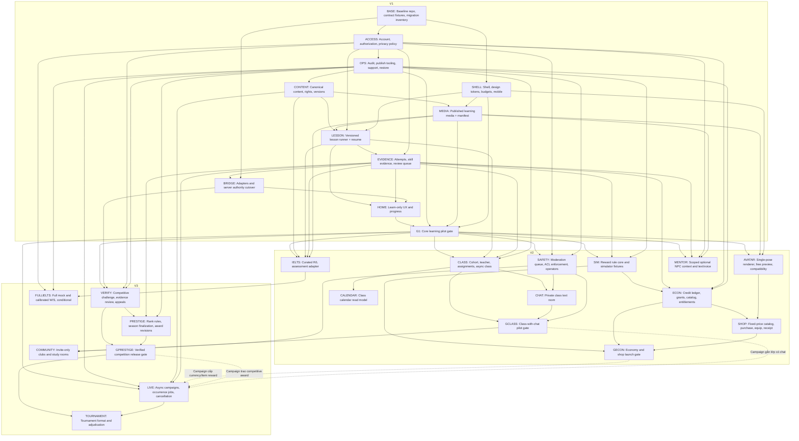

# V1/V2/V3 và dependency graph cuối cùng

Roadmap này thay thứ tự đề xuất trong [083](source/space_academy_detailed_plans_reviewed_v2_2026-10-09/083_recommended_build_order.md). Không có deadline/ước lượng nhân sự vì chưa có đội ngũ, throughput nội dung và traffic mục tiêu. Release theo gate; V2/V3 không có nghĩa mọi nhánh bắt buộc phải ra.

## 1. V1 — Một sản phẩm học hoàn chỉnh

**Outcome:** người học solo chọn mục tiêu, học bài có chất lượng, nhận feedback, quay lại ôn và thấy tiến bộ có căn cứ. Tắt toàn bộ meta vẫn làm được tất cả việc đó.

**Scope đóng:** một mini-course General English cho cohort A2–B1 người lớn như giả định pilot; khoảng 10–15 lesson ngắn là kích thước thử nội dung, không bằng chứng bao phủ cả trình độ. Read/listen/recall, lesson version, content license/review, error/hints evidence, deterministic review, private progress, resume/backup/migration, account, mobile, basic operations. Giữ game/adapters hiện có và free portrait. Prototype modular art chạy song song, không gate release.

**Không trong launch V1:** class chat, clubs, rankings public, live events, ví/shop, crystal/token/fragment, full IELTS, generative NPC memory, thêm hàng loạt game. Reject login payout và reward theo phút; 3D/trade/power economy không tự trở lại V3.

**Gate G1:**

- Mini-course có objective, answer/rubric, rights và reviewer rõ; nội dung không có learning defect nghiêm trọng chưa xử lý.
- Một learner hoàn thành và resume bài rồi ôn lại trên thiết bị mục tiêu; đường đó không gọi economy/social/game service. Có test meta disabled/unavailable.
- Retry, duplicate, out-of-order và đổi tab không nhân progress; local import giữ lịch sử nhưng không cấp reward/rank; rollback/cutover exercise không mất accepted attempts.
- Restore backup, publish version, takedown và lỗi worker có operator path. Account scoping không lộ tiến độ người khác.
- Budget đo theo tài liệu 02; accessibility/mobile/audio fallback đạt checklist core.
- Pilot quan sát delayed recall trên item phù hợp và spontaneous/voluntary return. Đặt trước câu hỏi đo, window và mức meaningful effect; chưa có dữ liệu thì không bịa threshold “retention phải X%”. Không mở rộng nếu chỉ time-spent tăng còn chất lượng học giảm.

**Thứ tự thực thi:** baseline/migration fixtures → auth/access + shell/design/budgets + ops → canonical content/rights/media → lesson runner → evidence/review → adapter/cutover → learn-only UX → G1. Brand prototype có thể song song sau baseline, không cần đợi backend.

## 2. V2 — Chọn nhánh mở rộng có kiểm soát

| Nhánh | Scope nhỏ nhất | Điều kiện mở | Exit gate |
|---|---|---|---|
| Classroom | Một teacher thật, cohort pilot, approved lessons, assignment, async path, lịch và debrief | G1; scoped access; moderation nếu có text room | GCLASS: không mất bài khi late/reconnect; đúng ACL; teacher vận hành được; chất lượng học không giảm |
| Social class | Private text room, report/block/mute và xử lý case; chưa DM/upload | Safety workflow + membership lifecycle | Operator cover và enforcement kiểm thử; chưa đủ người trực thì giữ classroom không chat |
| Identity/economy | Modular một pose/cỡ catalog nhỏ; một earned Credit; fixed-price cosmetic; auto receipt | G1; simulator; ledger/ownership/audit | GECON: concurrency/replay/reversal pass, learn-only vẫn đủ, art/perf đạt |
| IELTS training | Một pack Reading/Listening curated; hints vs timed practice rõ | Core assessment + rights/audio QA | Không hứa full mock/band; expert QA và autosave/clock recovery |
| Mentor | Scripted → contextual summary qua consent; optional generic TTS | Facts read API + privacy + cost cap | Không grant/grade; fallback text; feedback factual evaluation |

Class và identity/economy có thể thử độc lập. Không cần shop để học chung; không cần class để dùng avatar hoặc mua cosmetic. Có thể tiếp tục làm nội dung tốt hơn mà không mở nhánh nào.

Thử dải class size theo vận hành: pilot nhỏ 8–12, sau đó so 15–30 nếu teacher/moderation đủ. Tách return do tự chọn vào lớp khỏi tác động thực sự của lớp; thử nghiệm có đối chứng hoặc ít nhất ghi rõ selection bias. Không tuyên bố social “mạnh nhất” dựa trên quan sát tự chọn.

## 3. V3 — Competition và LiveOps đáng tin

| Hệ | Điều kiện tiên quyết | Scope đầu | Giới hạn |
|---|---|---|---|
| Ranked prestige | Server challenge/run evidence, review/appeal, comparable ruleset | Một leaderboard opt-in, pending→verified, result revisions | Không global English mastery rank; không xếp AI vào người thật |
| Season/Hall | Finalization/correction + award rules | Một season history đọc được | PII có thể redacted; lịch sử kết quả có amendment |
| LiveOps | Durable scheduler + ops + content/activity ổn định | Một async campaign, có cancel/expiry | Reward chỉ bật khi GECON; class-linked event chỉ khi GCLASS |
| Tournament | Verified results + scheduler + users/operator đủ | Một format đơn giản | Không tự bắt đầu bracket 256, spectators hoặc streaming |
| Community | Class social đã vận hành tốt | Invite-only club/study rooms rồi đánh giá discovery | Không mở DM/voice/video tự động |
| Full IELTS/Writing/Speaking | Rubric/content/model evaluation, privacy audio, cost/support | Chỉ phạm vi đạt calibration | Có thể hoãn ngoài V3; “Practice Estimate” không miễn yêu cầu chất lượng |

V3 là danh sách ứng viên có gate, không cam kết build tất cả. New game modes chỉ khi có learning objective/evidence mapping và cải thiện trải nghiệm đã đo.

## 4. Quy ước đồ thị

Mũi tên **A → B = B cần A trước khi hoàn thành capability/gate**. Đây là đồ thị prerequisite triển khai, không mô tả every runtime call hay event feedback loop. Runtime flows nằm riêng bên dưới. Bảng references trong review 106 mục là liên kết nội dung, có thể hai chiều; không dùng chúng để giả làm DAG.

Đường liền là prerequisite bắt buộc trong scope node đã chọn. Tính năng tùy chọn không nằm trên critical path G1. Trong graph, node `CLASS` là classroom cơ bản; `GCLASS` là gate pilot **có chat**, vì vậy lớp không chat có thể nghiệm thu riêng sau `CLASS` + safety kiểm ACL/profile. Không cần giả tạo Social là dependency của lesson runner.

`GECON` chỉ chặn phát hành nhánh có shop, không chặn preview art hoặc free portrait. `LIVE` không cần Economy nếu campaign không trả currency; khi chọn trả thưởng, cần GECON như **conditional gate**, không đưa ngược dependency khiến core bị kéo theo.

<!-- GRAPH_START -->


Đồ thị đầy đủ: [JSON](DEPENDENCY_GRAPH.json), [Mermaid](DEPENDENCY_GRAPH.mmd). Một thứ tự topo hợp lệ (các nhánh độc lập có thể đổi chỗ):

`BASE → ACCESS → SHELL → OPS → CONTENT → MEDIA → LESSON → EVIDENCE → BRIDGE → HOME → G1 → SAFETY → CLASS → AVATAR → SIM → IELTS → MENTOR → VERIFY → LIVE → CHAT → CALENDAR → ECON → FULLIELTS → PRESTIGE → GCLASS → SHOP → GPRESTIGE → COMMUNITY → GECON → TOURNAMENT`

| Node | Phase | Capability | Hard prerequisites | Mục nguồn |
|---|---|---|---|---|
| BASE | V1 | Baseline repo, contract fixtures, migration inventory | — | [070](source/space_academy_detailed_plans_reviewed_v2_2026-10-09/070_content_learning_data_foundation.md), [069](source/space_academy_detailed_plans_reviewed_v2_2026-10-09/069_space_typings_role.md), [082](source/space_academy_detailed_plans_reviewed_v2_2026-10-09/082_proposed_master_plan_document_split.md) |
| ACCESS | V1 | Account, authorization, privacy policy | BASE | [030](source/space_academy_detailed_plans_reviewed_v2_2026-10-09/030_user_identity_system.md), [078](source/space_academy_detailed_plans_reviewed_v2_2026-10-09/078_admin_game_master_learning_operations_console.md) |
| SHELL | V1 | Shell, design tokens, budgets, mobile | BASE | [003](source/space_academy_detailed_plans_reviewed_v2_2026-10-09/003_core_product_principles.md), [039](source/space_academy_detailed_plans_reviewed_v2_2026-10-09/039_visual_audio_brand_spine.md), [073](source/space_academy_detailed_plans_reviewed_v2_2026-10-09/073_performance_philosophy.md), [074](source/space_academy_detailed_plans_reviewed_v2_2026-10-09/074_asset_performance_budgets.md), [075](source/space_academy_detailed_plans_reviewed_v2_2026-10-09/075_mobile_as_a_first_class_experience.md) |
| OPS | V1 | Audit, publish tooling, support, restore | ACCESS | [078](source/space_academy_detailed_plans_reviewed_v2_2026-10-09/078_admin_game_master_learning_operations_console.md), [014](source/space_academy_detailed_plans_reviewed_v2_2026-10-09/014_lesson_builder.md) |
| CONTENT | V1 | Canonical content, rights, versions | OPS | [070](source/space_academy_detailed_plans_reviewed_v2_2026-10-09/070_content_learning_data_foundation.md), [071](source/space_academy_detailed_plans_reviewed_v2_2026-10-09/071_content_sources_licensing.md), [023](source/space_academy_detailed_plans_reviewed_v2_2026-10-09/023_core_learning_tracks.md) |
| MEDIA | V1 | Published learning media + manifest | CONTENT, SHELL | [072](source/space_academy_detailed_plans_reviewed_v2_2026-10-09/072_media_production_strategy.md), [040](source/space_academy_detailed_plans_reviewed_v2_2026-10-09/040_audio_design.md) |
| LESSON | V1 | Versioned lesson runner + resume | CONTENT, MEDIA, ACCESS, SHELL | [012](source/space_academy_detailed_plans_reviewed_v2_2026-10-09/012_lesson_as_a_sequence_not_a_page.md), [025](source/space_academy_detailed_plans_reviewed_v2_2026-10-09/025_mission_based_learning_structure.md) |
| EVIDENCE | V1 | Attempts, skill evidence, review queue | LESSON, ACCESS | [027](source/space_academy_detailed_plans_reviewed_v2_2026-10-09/027_personalized_learning_intelligence.md), [097](source/space_academy_detailed_plans_reviewed_v2_2026-10-09/097_learning_retention_principle.md) |
| BRIDGE | V1 | Adapters and server authority cutover | EVIDENCE, BASE | [026](source/space_academy_detailed_plans_reviewed_v2_2026-10-09/026_typing_experience.md), [069](source/space_academy_detailed_plans_reviewed_v2_2026-10-09/069_space_typings_role.md), [070](source/space_academy_detailed_plans_reviewed_v2_2026-10-09/070_content_learning_data_foundation.md) |
| HOME | V1 | Learn-only UX and progress | LESSON, EVIDENCE, BRIDGE | [085](source/space_academy_detailed_plans_reviewed_v2_2026-10-09/085_core_ux_example_simple_learner.md), [028](source/space_academy_detailed_plans_reviewed_v2_2026-10-09/028_knowledge_codex_collections.md), [029](source/space_academy_detailed_plans_reviewed_v2_2026-10-09/029_books_as_progress_objects.md) |
| G1 | V1 | Core learning pilot gate | HOME, OPS, MEDIA, SHELL | [083](source/space_academy_detailed_plans_reviewed_v2_2026-10-09/083_recommended_build_order.md), [097](source/space_academy_detailed_plans_reviewed_v2_2026-10-09/097_learning_retention_principle.md) |
| SAFETY | V2 | Moderation queue, ACL enforcement, operators | G1, ACCESS, OPS | [064](source/space_academy_detailed_plans_reviewed_v2_2026-10-09/064_social_system.md), [030](source/space_academy_detailed_plans_reviewed_v2_2026-10-09/030_user_identity_system.md) |
| CLASS | V2 | Cohort, teacher, assignments, async class | G1, LESSON, EVIDENCE, OPS | [008](source/space_academy_detailed_plans_reviewed_v2_2026-10-09/008_class_system.md), [009](source/space_academy_detailed_plans_reviewed_v2_2026-10-09/009_teacher_roles.md), [011](source/space_academy_detailed_plans_reviewed_v2_2026-10-09/011_class_time_lesson_structure.md), [015](source/space_academy_detailed_plans_reviewed_v2_2026-10-09/015_before_during_after_class.md), [019](source/space_academy_detailed_plans_reviewed_v2_2026-10-09/019_attendance_class_participation.md) |
| CHAT | V2 | Private class text room | CLASS, SAFETY | [064](source/space_academy_detailed_plans_reviewed_v2_2026-10-09/064_social_system.md), [065](source/space_academy_detailed_plans_reviewed_v2_2026-10-09/065_social_presence.md) |
| GCLASS | V2 | Class-with-chat pilot gate | CLASS, CHAT, SAFETY | [086](source/space_academy_detailed_plans_reviewed_v2_2026-10-09/086_core_ux_example_social_learner.md), [096](source/space_academy_detailed_plans_reviewed_v2_2026-10-09/096_social_retention_principle.md) |
| CALENDAR | V2 | Class calendar read model | CLASS | [013](source/space_academy_detailed_plans_reviewed_v2_2026-10-09/013_weekly_class_structure.md), [062](source/space_academy_detailed_plans_reviewed_v2_2026-10-09/062_event_calendar.md) |
| AVATAR | V2 | Single-pose renderer, free preview, compatibility | G1, MEDIA, SHELL | [031](source/space_academy_detailed_plans_reviewed_v2_2026-10-09/031_avatar_direction_current_preferred_decision.md), [032](source/space_academy_detailed_plans_reviewed_v2_2026-10-09/032_2d_avatar_layer_system.md), [033](source/space_academy_detailed_plans_reviewed_v2_2026-10-09/033_avatar_technical_template.md), [034](source/space_academy_detailed_plans_reviewed_v2_2026-10-09/034_avatar_pose.md) |
| SIM | V2 | Reward rule core and simulator fixtures | G1, EVIDENCE, OPS | [079](source/space_academy_detailed_plans_reviewed_v2_2026-10-09/079_reward_simulator.md), [043](source/space_academy_detailed_plans_reviewed_v2_2026-10-09/043_reward_system.md), [076](source/space_academy_detailed_plans_reviewed_v2_2026-10-09/076_reward_economy_anti_patterns_to_avoid.md) |
| ECON | V2 | Credit ledger, grants, catalog, entitlements | SIM, EVIDENCE, ACCESS, OPS | [050](source/space_academy_detailed_plans_reviewed_v2_2026-10-09/050_economy.md), [043](source/space_academy_detailed_plans_reviewed_v2_2026-10-09/043_reward_system.md), [047](source/space_academy_detailed_plans_reviewed_v2_2026-10-09/047_weekly_rewards.md), [048](source/space_academy_detailed_plans_reviewed_v2_2026-10-09/048_long_term_rewards.md) |
| SHOP | V2 | Fixed-price catalog, purchase, equip, receipt | ECON, AVATAR | [035](source/space_academy_detailed_plans_reviewed_v2_2026-10-09/035_avatar_shop_preview.md), [049](source/space_academy_detailed_plans_reviewed_v2_2026-10-09/049_reward_center.md), [051](source/space_academy_detailed_plans_reviewed_v2_2026-10-09/051_shop_system.md), [052](source/space_academy_detailed_plans_reviewed_v2_2026-10-09/052_stationery_as_a_signature_cosmetic_system.md) |
| GECON | V2 | Economy and shop launch gate | SIM, ECON, SHOP | [079](source/space_academy_detailed_plans_reviewed_v2_2026-10-09/079_reward_simulator.md), [076](source/space_academy_detailed_plans_reviewed_v2_2026-10-09/076_reward_economy_anti_patterns_to_avoid.md), [093](source/space_academy_detailed_plans_reviewed_v2_2026-10-09/093_what_must_never_be_sold.md) |
| IELTS | V2 | Curated R/L assessment adapter | G1, CONTENT, LESSON, EVIDENCE, MEDIA | [024](source/space_academy_detailed_plans_reviewed_v2_2026-10-09/024_ielts_as_a_first_class_track.md), [023](source/space_academy_detailed_plans_reviewed_v2_2026-10-09/023_core_learning_tracks.md) |
| MENTOR | V2 | Scoped optional NPC context and text/voice | G1, EVIDENCE, ACCESS, MEDIA | [010](source/space_academy_detailed_plans_reviewed_v2_2026-10-09/010_npc_ai_philosophy.md), [041](source/space_academy_detailed_plans_reviewed_v2_2026-10-09/041_npc_voice.md), [095](source/space_academy_detailed_plans_reviewed_v2_2026-10-09/095_living_even_when_alone_principle.md) |
| VERIFY | V3 | Competitive challenge, evidence review, appeals | G1, BRIDGE, ACCESS, OPS | [077](source/space_academy_detailed_plans_reviewed_v2_2026-10-09/077_prestige_integrity.md), [026](source/space_academy_detailed_plans_reviewed_v2_2026-10-09/026_typing_experience.md) |
| PRESTIGE | V3 | Rank rules, season finalization, award revisions | VERIFY, EVIDENCE, OPS | [054](source/space_academy_detailed_plans_reviewed_v2_2026-10-09/054_prestige_system.md), [055](source/space_academy_detailed_plans_reviewed_v2_2026-10-09/055_ranking_center.md), [057](source/space_academy_detailed_plans_reviewed_v2_2026-10-09/057_hall_of_fame.md), [058](source/space_academy_detailed_plans_reviewed_v2_2026-10-09/058_exclusive_prestige_cosmetics.md), [059](source/space_academy_detailed_plans_reviewed_v2_2026-10-09/059_item_provenance.md) |
| GPRESTIGE | V3 | Verified competition release gate | VERIFY, PRESTIGE | [077](source/space_academy_detailed_plans_reviewed_v2_2026-10-09/077_prestige_integrity.md), [087](source/space_academy_detailed_plans_reviewed_v2_2026-10-09/087_core_ux_example_competitive_user.md) |
| LIVE | V3 | Async campaigns, occurrence jobs, cancellation | G1, OPS, CONTENT, EVIDENCE | [061](source/space_academy_detailed_plans_reviewed_v2_2026-10-09/061_scheduled_events.md), [063](source/space_academy_detailed_plans_reviewed_v2_2026-10-09/063_school_events.md), [081](source/space_academy_detailed_plans_reviewed_v2_2026-10-09/081_liveops_admin.md), [099](source/space_academy_detailed_plans_reviewed_v2_2026-10-09/099_event_retention_principle.md) |
| TOURNAMENT | V3 | Tournament format and adjudication | GPRESTIGE, LIVE | [060](source/space_academy_detailed_plans_reviewed_v2_2026-10-09/060_tournaments_exams.md), [020](source/space_academy_detailed_plans_reviewed_v2_2026-10-09/020_class_competition.md) |
| COMMUNITY | V3 | Invite-only clubs and study rooms | GCLASS, SAFETY | [017](source/space_academy_detailed_plans_reviewed_v2_2026-10-09/017_clubs.md), [066](source/space_academy_detailed_plans_reviewed_v2_2026-10-09/066_study_rooms.md), [067](source/space_academy_detailed_plans_reviewed_v2_2026-10-09/067_friend_challenges.md) |
| FULLIELTS | V3 | Full mock and calibrated W/S, conditional | IELTS, ACCESS, OPS | [024](source/space_academy_detailed_plans_reviewed_v2_2026-10-09/024_ielts_as_a_first_class_track.md), [060](source/space_academy_detailed_plans_reviewed_v2_2026-10-09/060_tournaments_exams.md) |
<!-- GRAPH_END -->

## 5. Dependency điều kiện, không phải hard edges mặc định

| Feature được bật | Prerequisite bổ sung | Hành vi khi chưa đủ |
|---|---|---|
| Campaign có credit/limited item | GECON + event reward rule simulation | Campaign chỉ học/feedback, không payout |
| Campaign có competition award | GPRESTIGE + finalized verified result | Không hiển thị earned prestige reward |
| Campaign gắn lớp | GCLASS hoặc classroom gate không chat tương ứng | Campaign solo/async |
| Avatar equips purchased item | Economy entitlement API | Chỉ free starter/preview ephemeral |
| AI mentor dùng dữ liệu học | Consent + scoped summary + retention | Greeting script/text, không memory |
| Public leaderboard identity | Field visibility + moderation + verified policy | Private PB hoặc pseudonym |
| Full mock có AI W/S estimate | IELTS extension + calibrated model/rubric + audio privacy | Training feedback, không numeric band |

## 6. Runtime flows không tạo core dependency ngược

```mermaid
sequenceDiagram
    participant A as Activity / lesson UI
    participant L as Learning authority
    participant D as Database + outbox
    participant E as Economy worker (optional)
    participant P as Progress UI
    A->>L: Submit candidate attempt + stable id
    L->>D: Validate; commit evidence + projection/outbox
    D-->>L: Durable receipt
    L-->>A: Accepted / unverified / rejected + feedback
    L-->>P: Private progress and due review
    D-->>E: Accepted event (may repeat)
    E->>E: Dedupe + eligibility + cap
    E->>D: Atomic grant + ledger + receipt
    Note over A,P: Learning completes even if Economy is unavailable
```

Đây là event flow có optional side effect; Learning không chờ Economy callback để chấm học. Competition đọc result đã kiểm tra, không sửa Learning projection. NPC đọc summary, không ghi progress. Calendar đọc occurrence từ owner, không tạo source schedule thứ hai.

## 7. Gói triển khai reviewable đầu tiên

1. ADR owner/trust tier + fixtures bridge hiện có; mapping local→server; giữ feature flag.
2. Một lesson có version và rights với read/listen/recall, submission/resume và private review queue.
3. Backoffice tối thiểu publish/preview/takedown + account scope/audit.
4. Walkthrough thiết bị mobile/desktop, retry/offline/import/restore, budget waterfall.
5. Pilot gate review trước khi chọn nhánh V2; chưa khởi động shop/class/LLM như dependency bắt buộc.

Đây là bước triển khai đề xuất, chưa sửa code sản phẩm trong tác vụ review này.
